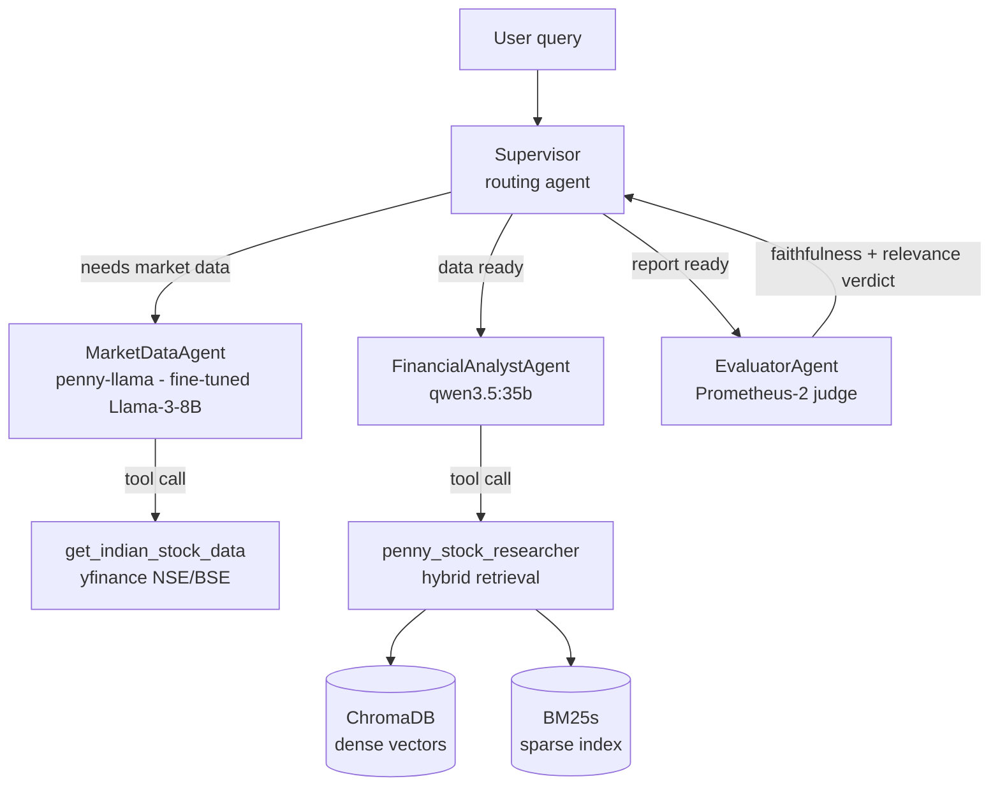

# PennyStockLLM 📈

A **local, multi-agent LLM system for penny-stock research** — combining retrieval-augmented
generation (RAG) over a 700-page penny-stock book, live NSE/BSE market data, and a
**custom QLoRA fine-tuned Llama-3-8B** that powers the data-fetching agent. Everything runs
locally on Apple Silicon (M4 Max) via MLX, llama.cpp, and Ollama.

## Architecture



- **LangGraph** supervisor pipeline with strict sequential routing (data → analysis → judge)
- **Hybrid RAG**: ChromaDB dense retrieval + BM25s sparse retrieval (ensemble) over the book corpus
- **LLM-as-judge**: Prometheus-2 scores every analyst report for faithfulness & relevance
- All models served locally by **Ollama**

## The fine-tuned model: `penny-llama`

The MarketDataAgent runs a **Llama-3-8B fine-tuned with QLoRA** (MLX, Apple Silicon) to emit
reliable `get_indian_stock_data(symbol, exchange)` tool calls for Indian equities.

| | |
|---|---|
| Method | QLoRA — LoRA rank 16 on a 4-bit MLX base, ~0.26% params trained |
| Data | 540 balanced synthetic examples, 50 NSE/BSE stocks, 3 behaviors (tool call / success reply / error passthrough) |
| Result | Correct ticker + exchange on all held-out smoke tests, incl. stocks unseen in training; verified end-to-end through Ollama + LangChain `bind_tools` |
| Deploy | fuse → GGUF → `Q4_K_M` quant → Ollama Modelfile (llama3.2 tool template) |

**Debugging story worth reading:** the first training run learned the *tool-call format*
perfectly but collapsed every ticker to `"BANK"` — caused by an unbalanced, bank-heavy
dataset and a hot learning rate. Fixed by strictly balancing examples per stock and halving
the LR. Details in [finetune/README.md](finetune/README.md).

## Repo layout

| Path | What it is |
|---|---|
| `Stocks_PG_Code.ipynb` | Main multi-agent LangGraph pipeline |
| `finetune/generate_dataset.py` | Balanced synthetic dataset generator (tool-calling) |
| `finetune/data/` | train/valid JSONL (mlx-lm chat format with tools) |
| `finetune/test_adapter.py` | Held-out smoke tests for the adapter |
| `finetune/README.md` | Full 10-step fine-tune → deploy pipeline |
| `ENTERPRISE_ROADMAP.md` | Roadmap: evals, FastAPI/Postgres, MLOps, AWS/K8s |

Large artifacts (model weights, GGUFs, vector DB, corpus PDFs) are kept out of git — see
`.gitignore`. The full pipeline to rebuild them is documented in `finetune/README.md`.

## Quickstart

```bash
# 1. Serve the fine-tuned model (needs the GGUF built per finetune/README.md)
ollama create penny-llama -f /path/to/Modelfile
# 2. Env: conda env with langchain, langgraph, langchain-ollama, chromadb, bm25s, yfinance
# 3. Run Stocks_PG_Code.ipynb top to bottom
```

## Stack

Python · LangChain · LangGraph · Ollama · MLX (`mlx-lm`) · llama.cpp · ChromaDB · BM25s ·
yfinance · HuggingFace Transformers

## Roadmap

Production hardening in progress — evaluation harness (RAGAS), FastAPI + PostgreSQL backend,
Docker/MLflow/Langfuse MLOps, AWS deployment. See [ENTERPRISE_ROADMAP.md](ENTERPRISE_ROADMAP.md).
